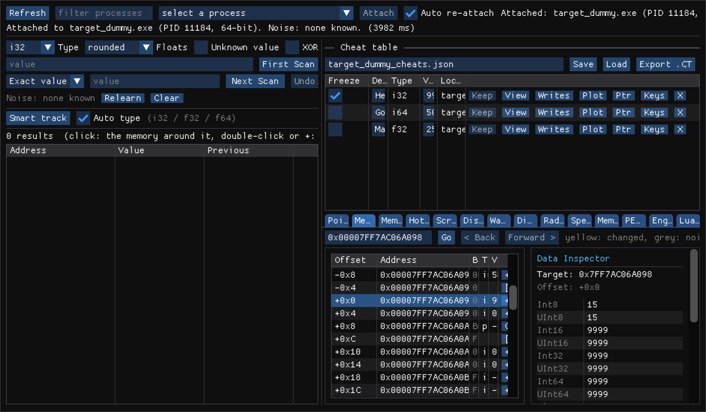
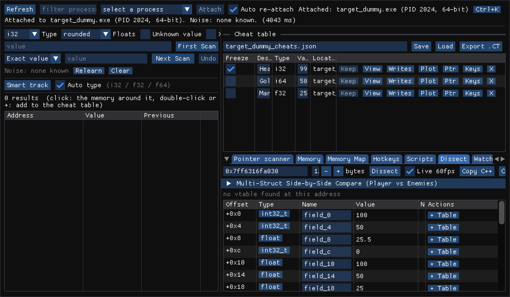
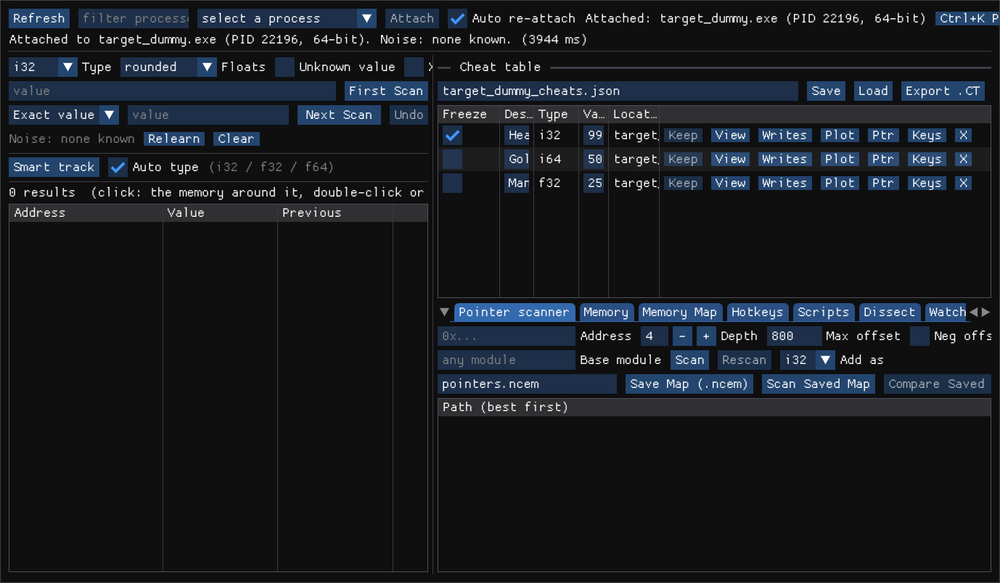

# New-Cheat-Engine (NCE)

[](https://github.com/AshrafCode519/New-Cheat-Engine/actions/workflows/ci.yml)
[](https://isocpp.org/)
[](LICENSE)
[](https://github.com/AshrafCode519/New-Cheat-Engine)
[](tests/)

> **⚠️ تنويه وإخلاء مسؤولية (Disclaimer):** هذا المشروع مخصّص لأغراض **التعليم، الهندسة العكسية، البحث الأمني، وتعديل الألعاب الفردية (Offline/Single-Player)** فقط.
> Intended strictly for **educational reverse engineering, security research, and single-player/offline game analysis**.

محرك حديث عابر للمنصات (**Windows + Linux**) مكتوب بلغة **C++20** بدون اعتماديات خارجية مسبقة التثبيت لفحص وتعديل الذاكرة والهندسة العكسية، ويضم واجهة رسومية متكاملة (**Dear ImGui + DirectX 11** على ويندوز و**SDL2 + OpenGL 3** على لينكس) وأداة سطر أوامر تفاعلية (`memscan_cli`) ومحرك سكربتات **Lua 5.4** و**Auto-Assembler** مدمج.

### Quick Start (English Summary)
- **NCE v3.0 Highlights:** Copy-On-Write x86/x64 `MicroEmulator` + Backward Taint Slicer, Stealth `PAGE_GUARD` Watch + `ProtectionInspector` (Anti-Debug / IAT-Hook / RWX), NCE3 encrypted remote protocol (SHA-256 CTR + HMAC, Remote Debug/Watch/Speedhack), Pure C++ MSF 7.00 `.pdb` reader, Godot + One-Click C++20 `SDK.hpp`/`.CT` Dumper, Lua `PluginManager` (`plugins/*.lua`), Modular GUI + Workspace JSON Persistence, and Live OS `engine_live_tests`.
- **Prebuilt Releases:** Ready-to-run Windows (`nce_gui.exe`, `memscan_cli.exe`, `nce_server.exe`, `nce_veh.dll`, `target_dummy.exe`) and Linux (`nce_gui`, `memscan_cli`, `nce_server`, `target_dummy`) packages can be downloaded from [GitHub Releases](https://github.com/AshrafCode519/New-Cheat-Engine/releases) when tagged.
- **Windows (MinGW / CMake):** `cmake -B build -G "MinGW Makefiles" && cmake --build build -j 4` -> outputs `build/bin/nce_gui.exe`, `build/bin/memscan_cli.exe`, `build/bin/nce_server.exe`, `build/bin/nce_veh.dll`, `build/bin/target_dummy.exe`, and `build/bin/engine_tests.exe`.
- **Linux (GCC / CMake):** `sudo apt install libsdl2-dev libgl-dev && cmake -B build && cmake --build build -j 4` -> outputs `nce_gui`, `memscan_cli`, `nce_server`, `target_dummy`, and `engine_tests` (`LinuxProcess`, `ptrace` debugger, `ELFAnalyzer` + DWARF, `clock_gettime` speedhack).
- **Third-Party Libraries Included (`third_party/`):** Dear ImGui (MIT), Lua 5.4.7 (MIT), doctest (MIT), nlohmann/json (MIT).
- **Contributing:** See [CONTRIBUTING.md](CONTRIBUTING.md) for local build instructions and cross-platform PR guidelines.

---

## 📸 Screenshots

| Memory Viewer & Live Data Inspector | Live Structure Dissector (Auto Type Inference) |
| :---: | :---: |
|  |  |

<details>
<summary>Scanner, Cheat Table & Pointer Scanner View</summary>



</details>

---

## 🏛 المعمارية والمكونات الحالية

1. **`target_dummy` (الهدف التجريبي المعياري):**
   * عملية اختبار تفاعلية توفر بنية ذاكرة محددة بدقة (Known Values):
     * أعداد صحيحة 32-bit و 64-bit (`health`, `gold`).
     * أعداد حقيقية Float و Double (`mana`, `speed`).
     * نصوص ASCII (`player_name`).
     * هياكل بيانات مجمعة (Grouped Structs) لاختبار فحص القيم المتجاورة (`PlayerStats`).
     * قيم مشفرة بنظام XOR (`ObfuscatedValue`).
     * سلاسل مؤشرات متعددة المستويات (Multi-level Pointers: Base -> L1 -> L2 -> L3 -> Target).
     * وضع محاكاة التغيرات التلقائية (Auto-Decay) لاختبار Next Scan.

2. **`engine` (نواة المحرك):**
   * **طبقة تجريد النظام (HAL):**
     * واجهة `IProcess` للتعامل الشفاف مع **Windows و Linux** (`/proc/<pid>/maps`, `process_vm_readv/writev`, `ptrace`).
     * فحص ذكي لصفحات الذاكرة عبر `VirtualQueryEx` مع استبعاد صفحات الـ Guard و NoAccess.
     * كتابة آمنة على الذاكرة مع إدارة الصلاحيات تلقائياً (`VirtualProtectEx`).
     * تجميد واستئناف العمليات الهدف (`NtSuspendProcess` / `NtResumeProcess`) لمنع القراءات الممزقة (Torn Reads).
     * استخراج وتصنيف وحدات البرنامج (Modules) لحساب قواعد المؤشرات (Base Offsets).
     * أزرار اختصار على مستوى النظام كله (`IHotkeys`)، شغالة واللعبة قدامك. ليها thread لوحدها بيستناها، فبتشتغل في الـ CLI كمان مع إنه ملوش نافذة.
   * **محرك الفحص المتوازي (MemoryScanner):**
     * فحص متوازي متعدد الخيوط (Multithreaded Chunk Scanning).
     * دعم مختلف أنواع البيانات (`Int8`..`Int64`, `UInt8`..`UInt64`, `Float`, `Double`, `AOB`)، والنصوص UTF-8 (`str`) و UTF-16 (`wstr`).
     * البحث عن قيمة غير معروفة (Unknown Initial Value): لقطة (Snapshot) للذاكرة ثم مقارنة الذاكرة الحية بيها. اللقطة بتصغر مع كل فلترة (bit لكل عنوان مرشح، والـ blocks الفاضية بتتشال).
     * نتائج مضغوطة: 16 بايت لكل نتيجة i32، والـ Next Scan بيقرا العناوين المتجاورة في قراءة واحدة وعلى كل الخيوط.
     * مطابقة الأعداد العشرية زي Cheat Engine: `rounded` (الافتراضي) و `truncated` و `exact`، حسب عدد الأرقام العشرية المكتوبة.
     * بحث متقدم عن أنماط البايتات مع الرموز البديلة (`AOB Scan with '?' wildcards`).
     * فحص ترشيحي متسلسل (Next Scan): `Exact`, `Changed`, `Unchanged`, `Increased`, `Decreased`, `GreaterThan`, `LessThan`, `Between`, `IncreasedBy`, `DecreasedBy` (نتائج AOB تدعم `Changed` و `Unchanged` فقط).
   * **الفحص المجمع (Grouped Scanner):**
     * البحث عن متغيرات متعددة تقع متجاورة ضمن نفس الـ Struct في نافذة ذاكرة محددة (مثل `health` و `mana` و `armor` ضمن 256 بايت).
     * يقلص النتائج العشوائية الخاطئة بنسبة 99.9% في فحص واحد.
   * **فاحص المؤشرات (Pointer Scanner & Pointer Map):**
     * بناء خريطة مؤشرات مفهرسة ومرتبة بالـ Binary Search.
     * خوارزمية بحث عكسي (Reverse BFS) من العنوان الهدف إلى قواعد الـ Modules الثابتة.
     * استخراج سلاسل المؤشرات بهيئة `[module.exe + offset] -> [offset1] -> [offset2]`.
   * **عارض الذاكرة (MemoryView):**
     * بيقرا الذاكرة حوالين أي عنوان وبيخمّن كل 4 bytes هي إيه: int، أو float، أو double، أو i64، أو pointer (لـ `game.exe+0x1A0` أو للـ heap)، أو نص. التخمين بيعتمد على مدى منطقية القيمة: الـ float بتاع الصحة لو اتقرا int بيبقى رقم ضخم، والـ pointer لازم يشاور على ذاكرة موجودة فعلاً.
     * بيعلّم القيم اللي اتغيرت بين كل قراية والتانية، والقيم اللي خريطة الضوضاء بتقول إنها بتتغير لوحدها.
   * **مفكك الهياكل (StructureDissector):**
     * بيحوّل أي object أو pointer في اللعبة لـ C++ struct: بيلاقي الـ vtable ويعدّ دوالها، وبيطلّع اسم الكلاس من الـ RTTI (نظام MSVC اللي أغلب الألعاب عليه، ونظام GCC/Itanium)، وبيسمّي كل field بنوعه (float، int، char\*، pointer لـ object تاني باسم كلاسه).
     * بيصدّر `struct` جاهز تلزقه في header.
   * **محرك الـ Auto-Assembler والمجمّع (`x86_assembler` + `AutoAssembler`):**
     * مترجم تعليمات x86-64/x86 (MOV/LEA، العمليات الحسابية والمنطقية، SSE/SIMD، تحويلات الأرقام `cvtsi2ss`/`cvttss2si`، فحص البتات `bt`/`bts`/`btr`/`bsf`، `bswap`، القفزات والنداءات، `db`).
     * تشغيل سكربتات `[ENABLE]`/`[DISABLE]` و`{$lua}` و`alloc` و`label` و`define` و`assert` و`aobscanmodule` و`registersymbol` مع استرجاع تلقائي عند التعطيل.
   * **المنقح التفاعلي وكشف التسريع والمقارنة التفاضلية (`StepDebugger`, `DebugCoordinator`, `VEH`, `HookEngine`, `Speedhack`, `MemoryDiff`):**
     * تنقيح تفاعلي متكامل بـ **Win32 Debug API** أو **وكيل VEH داخل العملية (`nce_veh.dll`)** أو **`ptrace` على Linux/Steam Deck** مع دعم `INT 3` ونقاط التوقف الشرطية (`ConditionEvaluator`) وتتبّع التنفيذ (`tracebp` / `tracelog`) وسجل المكدس (`CallStack`).
     * محرك الحقن (`HookEngine`) لزرع Code Caves وDetours، ومحرك تسريع الوقت (`Speedhack`) على Windows (`QPC`/`GetTickCount64`/`timeGetTime`) وLinux (`clock_gettime`).
     * أداة `MemoryDiff` لأخذ لقطتين للذاكرة ومقارنة البايتات المتغيرة، و`UltimapProfiler` لاصطياد الدوال التي تُستدعى عند تنفيذ حركة معينة داخل اللعبة، وعارض التدفق الرسومي (`Control-Flow Graph / CFG`) في المفكك.
   * **محللات الثنائيات ومحركات الألعاب (`PEAnalyzer`, `ELFAnalyzer`, `EngineInspector`):**
     * فحص ترويسات وأقسام وتصدير/استيراد ملفات **PE32/PE32+** على ويندوز و**ELF32/ELF64** على لينكس مع حقن أسماء الدوال في المفكك (`resolve_symbol`).
     * فاحص **Unity (Mono / IL2CPP)** لقراءة `global-metadata.dat` من القرص أو من الذاكرة الحية مباشرةً (`0xFAB11BAF`) وتشريح الكائنات الحية (`Il2CppClass` + إزاحات الحقول)، وفاحص **Unreal Engine 4/5** مع البحث التلقائي عن `GNames` و`GUObjectArray` وتشريح `FField`/`UStruct` وقائمة `UWorld Actors` ثلاثية الأبعاد.
   * **محرك سكربتات Lua 5.4.7 المدمج (`LuaEngine`):**
     * واجهة Lua متوافقة مع Cheat Engine (`readInteger`/`Float`/`String`/`Bytes`، `write*`، `AOBScan*`، `autoAssemble`، `installHook`، `setBreakpoint`، `debugger_onBreakpoint`، `setSpeed`، `createTimer`، `createHotkey`، و`analyzePE`/`ELF` و`detectEngine`/`findUnrealGlobals`/`dumpUnrealActors`/`inspectUnityMemory`/`buildCFG`).
   * **مولد المدرب المستقل (`StandaloneGenerator`):**
     * تصدير جدول الغش إلى ملف C++ مستقل بدون مكتبات خارجية لـ **Win32 Console** أو **Win32 Native GUI** أو **Linux Console** (`process_vm_writev`).
   * **دعم المنصات والمحاكي:**
     * طبقة Linux في `LinuxProcess` (`/proc/<pid>/maps`, `process_vm_readv/writev`, `ptrace` `mmap`/`munmap`)، وحاقن `.so` عبر `dlopen`، ومفاتيح اختصار X11 (`libX11.so.6`).
     * دعم القيم Big-Endian لألعاب محاكيات **Dolphin / RPCS3**.
   * **طبقة الجلسة (Session) وربط الأهداف البعيدة (`RemoteServer` / `nce_server`):**
     * كل اللي محتاجه هدف متصل في مكان واحد: العملية، الفحص الحالي مع الـ undo، خريطة الضوضاء، جدول الغش مع خيط التجميد (كل 100ms)، ومسارات المؤشرات.
     * دعم العمل الشبكي عبر **`RemoteProcess`** وخادم **`nce_server`** (`NCE2` TCP Protocol مع رمز توثيق `--token`) لفحص وتعديل العمليات عن بُعد (Windows ↔ Linux / WSL / Steam Deck / LAN).
   * **محرك v2.0 للتحليل المتقدم (Next-Gen RE Suite):**
     * **المفكك العكسي (`PseudoCDecompiler`):** يحوّل رسوم التدفق (`CFG`) إلى كود **Pseudo-C** مقروء مع تعويض أسماء الدوال وأسماء حقول الهياكل تلقائياً (`rcx->health`) وكشف الحلقات والشرطيات.
     * **الخط الزمني السببي (`CausalityTimeline`):** تسجيل متسلسل لنبضات التنفيذ وتغير السجلات والذاكرة مع إمكانية الرجوع والتقديم الزمني ومقارنة اللقطات (`Time-Travel Debugging`).
     * **الجداول ذاتية الإصلاح (`SignatureAnchor`):** ربط عناصر الجدول ببصمة تعليمات AOB مع إزاحة `[rip + disp32]` لإعادة توجيه العناوين تلقائياً بعد تحديثات اللعبة (`migrate_table_by_signatures`).
     * **محلل Proton / Wine الهجين (`inspect_hybrid_modules`):** فحص ثنائيات PE المعيّنة داخل عمليات Linux بجانب مكتبات ELF في عرض موحد.
     * الـ CLI والواجهة الاتنين واجهات عليها: منطق الفحص والـ attach وإعادة الاتصال والجدول مكتوب مرة واحدة وعليه اختبارات، والواجهات بتقرا الأوامر وتعرض النتايج بس.

3. **`memscan_cli` (أداة سطر الأوامر التفاعلية):**
   * عرض العمليات الحية والبحث بالاسم (`ps`).
   * الاتصال بالعملية (`attach <pid>`).
   * فحص الذاكرة وتصفية النتائج (`scan`, `next`, `list`)، والبحث عن قيمة غير معروفة (`scan i32 ?`).
   * الرجوع لنتائج الفحص السابق (`undo`)، وحفظ وتحميل النتائج (`save`, `load`)، وطريقة مطابقة الأعداد العشرية (`floatmode`).
   * البحث الموجّه بترتيب ذكي (`track auto` أو `track i32`، أو زرار Smart track في الواجهة): وإنت سايب القيمة، العناوين اللي بتتغير لوحدها بتخسر نقط، وبعد ما تغيّرها بتقوله اتغيرت إزاي (`+` / `-` / `c` / القيمة الجديدة). كل عنوان بياخد درجة وسبب (اتغير زي ما قلت كام مرة، بنفس المقدار ولا لأ، قيمته منطقية ولا لأ)، فإجابة غلط واحدة بتنزّل العنوان الصح بدل ما تمسحه.
   * اكتشاف النوع أوتوماتيك (`track auto` / Auto type): بيتابع i32 و f32 و f64 مع بعض على نسخة واحدة من الذاكرة، والنوع الغلط بيبان من قيمه غير المنطقية (صحة float لو اتقرت i32 بتبقى رقم ضخم، والعكس رقم صغير جداً)، فالترتيب بيختار العنوان والنوع مع بعض.
   * خريطة الضوضاء (`noise`): بعد الـ attach البرنامج بيراقب الذاكرة 4 ثواني (وإنت سايب اللعبة)، وأي عنوان اتغير في نص المرات أو أكتر (عدادات، أنيميشن، buffers صوت) بيتجاهل في كل الفحوصات، والـ blocks اللي أغلبها ضوضاء ماتتقراش أصلاً. القيمة اللي بتدور عليها بتتغير بس لما تعمل حاجة، فمش بتوصل للحد ده. `noise clear` بيرجّع كل العناوين، و`noise learn [ثواني]` بيتعلم من تاني.
   * القيم الدايمة (`tperm <#>` أو زرار Keep في الواجهة): بيدوّر على pointer paths للقيمة ويحتفظ بأفضل 1000 منها مع الـ bytes اللي حواليها. بعد ما اللعبة تتقفل وتتفتح، الـ `attach` و`tload` بيلاقوا القيمة لوحدهم: المسارات بتصوّت، والعنوان اللي جيرانه شبه المحفوظين هو اللي بيكسب (التصويت لوحده ممكن يتخدع لأن مسارات كتير بتعدّي من نفس هياكل الـ heap)، والمسارات اللي اختلفت بتتشال. كل كلمة من الجيران بتتحسب حسب قربها من القيمة: الجيران المباشرين جزء من نفس الـ object، والبعيدين ممكن يكونوا headers موجودة في أي block في الـ heap بنفس الحجم.
   * أزرار اختصار عامة أثناء Smart track في الواجهة: تفضل جوه اللعبة وتدوس Num0 قبل ما تغيّر القيمة، وبعدها Num- (نزلت) أو Num+ (زادت) أو Num* (اتغيرت)، أو Ctrl+Shift+1 ثم 2 / 3 / 4 لو مفيش numpad. البرنامج بيرد بصوت.
   * إعادة الاتصال أوتوماتيك: لما اللعبة تتقفل، الواجهة بتلاحظ وبتستنى نفس البرنامج يفتح تاني، وبعد 3 ثواني بتعمل attach لوحدها، والقيم الدايمة بتتلاقي والتجميد بيرجع (Auto re-attach). في الـ CLI الأمر `reattach` بيعمل نفس الحاجة.
   * الفحص المجمع (`group i32 100 i32 50 f32 25.5`).
   * فحص سلاسل المؤشرات (`ptrscan <addr> [depth] [offset] [module]`)، مرتبة من الأفضل: الـ module الرئيسي، ثم أصغر مجموع offsets.
   * إعادة الفحص بعد إعادة تشغيل الهدف (`ptrrescan <new addr>`) عشان يفضل المسار الحقيقي بس، وحفظ وتحميل المسارات (`ptrsave`, `ptrload`, `ptrlist`). بيدعم العمليات الـ 32-bit (WOW64).
   * قراءة وكتابة وتعديل قيم الذاكرة الحية (`read`, `write`).
   * مكتبة الجداول: كل برنامج ليه جدول متحفظ باسمه في `%APPDATA%\NewCheatEngine\tables`.
     * أول ما تعمل attach للعبة جدولها بيتفتح لوحده: القيم الدايمة بتلاقي عناوينها، والتجميد والأزرار بيرجعوا.
     * الجدول بيتحفظ لوحده كل ثانيتين لو اتغير، ولما تقفل البرنامج.
     * لو اتنقلت لبرنامج تاني جدول الأول بيتحفظ وبيتفتح جدول التاني، ولو نفس اللعبة اتقفلت وفتحت تاني الجدول بيفضل زي ما هو.
     * `library` بيعرض المكتبة، و`library <folder>` بيغيّر مكانها، و`library off` بيقفلها، و`library save` بيحفظ دلوقتي. أما `tsave` و`tload` فلنسخة تشاركها أو تحتفظ بيها.
   * أزرار اختصار لجدول الغش وإنت جوه اللعبة (`thotkey <#> <keys> toggle | set <value> | add <amount> | remove`، أو تاب Hotkeys في الواجهة، وفيه زرار Record بيسجّل الزرار اللي تدوس عليه): `thotkey 0 F1 toggle` بيجمّد #0 ويفك تجميده، و`thotkey 0 Ctrl+F2 set 999` بيكتب 999، و`thotkey 1 Num5 add -10` بينقّص 10. بتتحفظ مع الجدول، والبرنامج بيصفّر لما تشتغل (صوت عالي معناه اتعمل، وواطي معناه فشل).
     * زرار واحد ممكن يشغّل أكتر من قيمة، والإضافة لقيمة متجمدة بتبدأ من القيمة المتجمدة.
     * الحروف والأرقام والمسافة والأسهم لازم معاها Ctrl أو Alt، لأن الزرار العام بياخد المفتاح من كل البرامج، فلو ربطت W لوحده مش هتعرف تكتب W في أي مكان. F1–F24 والـ numpad ينفعوا لوحدهم.
     * لو برنامج تاني ماسك نفس الزرار بيظهرلك إنه مش هيشتغل. و`thotkeys` بيعرضهم كلهم، و`tpress <keys>` بيجرّب الزرار من غير كيبورد.
   * تجميد القيم: `freeze <addr> <type> <val>` بيضيف العنوان لجدول الغش متجمد (فـ `table` و`tsave` و`tperm` بيشتغلوا عليه)، `frozen` بيعرض المتجمد، و`unfreeze [#|all]` بيفك التجميد.
   * استعراض الذاكرة بتنسيق Hex Dump (`dump <addr> [bytes]`).
   * الذاكرة حوالين قيمة (`view <addr>` أو `view #<result>` أو `view t<entry>`، أو تاب Memory في الواجهة): القيم اللي جنب القيمة اللي لقيتها غالباً من نفس الـ object (الـ max health، الذخيرة، المكان)، فبتضيفهم للجدول من غير فحص جديد. لو كتبت `view` تاني بيعلّم اللي اتغير من آخر مرة، وفي الواجهة العرض بيتحدّث 5 مرات في الثانية: الأصفر اتغير دلوقتي، والرمادي بيتغير لوحده. وزرار Go على أي pointer بيروح للمكان اللي بيشاور عليه، وBack بيرجّعك.
   * **المميزات الإضافية في الـ CLI والواجهة الرسومية (`nce_gui` + `memscan_cli`):**
     * تبويبات كاملة بالواجهة الرسومية لـ **Pointer Scanner (مع حفظ ومقارنة `.ncem`)**, **Memory**, **Memory Map (Modules / Regions / Threads)**, **Hotkeys**, **Scripts**, **Dissect (RTTI + Nested Pointer Tree + JSON Export + Multi-Struct Compare)**, **Watch**, **Disasm (32/64-bit, x87 FPU, AVX/VEX, Step Debugger + Break & Trace + Pan/Zoom CFG Flow Graph + X-Refs + Ultimap Profiler + One-Click `AA` Code-Cave Gen)**, **Radar 3D (Float3 / UE5 Double3 + Unreal Actors Overlay)**, **Speedhack**, **Mem Diff**, **PE / ELF Tools**, **Engine Inspector (Unity IL2CPP/Mono + Unreal `GWorld`/Auto-Finder + Auto-Calibrate Offsets)**، **Lua 5.4 Script Studio**، ولوحة الأوامر السريعة **`Ctrl+K`**.
     * أوامر الـ CLI الموسّعة: `disasm`, `xrefs`, `ptrmap <save|scan|cmp>`, `aobscript`, `cfg`, `ultimap`, `pe`, `elf`, `engine`, `unity <file|mem|obj>`, `unreal <find|names|objects|dissect|actors|calibrate>`, `lua`, `runlua`, `aobscan`, `aa`, `hook`, `detour`, `bp`, `tracebp`, `tracelog`, `dbgattach [win32|veh]`, `step`, `stepover`, `stepout`, `inject`, `gentrainer <out.cpp> [proc] [gui|linux]`.
   * تفكيك object لـ C++ struct (`dissect <addr|#result|t#> [bytes]`، أو تاب Dissect في الواجهة مع أزرار Copy C++ / Copy JSON وفتح المؤشرات كشجرة متداخلة): بيطلّع اسم الكلاس من الـ RTTI، الـ vtable وعدد دوالها، وكل field بنوعه.
   * سكربتات Auto-Assembler وتوليدها تلقائياً (`aobscript` / زر `AA` في المفكك / دالة Lua `generateAOBScript`): بتتكتب بـ `[ENABLE]`/`[DISABLE]`، بتتحفظ مع الجدول، وبتشتغل وتتقفل أوتوماتيكياً مع `attach`/`detach`. **لألعاب أوفلاين بس — بتعدّل كود اللعبة.**

4. **`nce_server` (خادم الأهداف البعيدة - Remote Target Daemon):**
   * خادم TCP خفيف ببروتوكول `NCE2` الثنائي يتيح استكشاف وفحص وتعديل العمليات عن بُعد من `nce_gui` أو `memscan_cli`:
   ```powershell
   .\build\bin\nce_server.exe --host 0.0.0.0 --port 52736 --token mysecret
   ```
   * ثم الاتصال من الواجهة عبر زر **`Remote...`** أو من سطر الأوامر via `remote 192.168.1.10 52736 mysecret`.
   * **أوامر CLI v2.0 الجديدة:** `remote`, `local`, `decompile`, `timeline`, `hybrid`, `tanchor`, `tmigrate`, `tlua`, `eval`.
   * **نوافذ GUI v2.0 الجديدة:** وضع **Pseudo-C** و **Causality** داخل المفكك، شريط مناطق الذاكرة البصري `ImDrawList`، طرفية **Lua 5.4 REPL** وجدول **Live Watch Expressions** وبانر `<LuaScript>`، وأزرار **`Anchor AOB` / `Migrate Sigs` / `Scan Hybrid PE+ELF`**.

---

## 🚀 كيفية البناء والتشغيل

### البناء (CMake + MinGW / C++20):
```powershell
cmake -B build -G "MinGW Makefiles"
cmake --build build
```

### الواجهة الرسومية (Dear ImGui):
البناء بيطلّع `build\bin\nce_gui.exe`: اختيار العملية، الفحص (First / Next / Undo / قيمة مش معروفة)، النتائج، جدول الغش (تجميد وتعديل وحفظ JSON)، والـ Pointer Scanner مع Rescan، وتاب Memory (دوسة على عنوان أي نتيجة، أو زرار View في الجدول، بتفتح الذاكرة اللي حواليه).
```powershell
.\build\bin\nce_gui.exe                                  # تشغيل عادي
.\build\bin\nce_gui.exe --pid 1234 --table game.json    # اتصال مباشر بعملية وتحميل جدول
.\build\bin\nce_gui.exe --pid 1234 --view 0x7FF6A0B0C078 # يفتح تاب Memory على العنوان ده
.\build\bin\nce_gui.exe --pid 1234 --table game.json --tab hotkeys # يبدأ على تاب Hotkeys
.\build\bin\nce_gui.exe --library D:\my-tables           # مكتبة الجداول في فولدر تاني (أو off)
.\build\bin\nce_gui.exe --pid 1234 --screenshot ui.bmp  # يرسم الواجهة في نافذة مخفية ويحفظها صورة (للاختبار)
```

### تشغيل الاختبارات (doctest):
```powershell
.\build\bin\engine_tests.exe
# أو عبر CTest:
ctest --test-dir build --output-on-failure
```
تغطي الاختبارات (`194 test cases / 17,897 assertions`) محرك الفحص عبر `FakeProcess` بالإضافة لاختبارات حيّة على `Win32Process` و`LinuxProcess` (`ptrace` + `ELFAnalyzer` DWARF)، و`HookEngine` (64-bit + 32-bit)، و`Speedhack`، و`Lua 5.4`، و`Disassembler`/`X86Assembler` (`x64/x86/AVX/x87/X-Refs/Atomics/SSE2`)، و`ScanResults` (تفريغ القرص)، و`CETableFormat` (مع `SignatureAnchor` و`<LuaScript>`)، و`PointerMap`، و`EngineInspector` (`Unity / Unreal`)، و**WOW64 (32-bit debugging)**، بالإضافة لـ **`PseudoCDecompiler`** و**`CausalityTimeline`** و**`RemoteServer`/`RemoteProcess`** (المحصّن بحدود الاتصال والمصادقة) و**Hybrid PE+ELF**. لإيقاف بناء الاختبارات: `-DNCE_BUILD_TESTS=OFF`.

### التشغيل والاختبار:
1. قم بتشغيل الهدف التجريبي:
```powershell
.\build\bin\target_dummy.exe
```
2. في نافذة أخرى، شغل أداة الفحص:
```powershell
.\build\bin\memscan_cli.exe
```
3. داخل أداة الفحص:
```text
attach <PID_المعروض_في_الهدف>
scan i32 1337
list
write <العنوان_المكتشف> i32 99999
```
ستلاحظ تغير قيمة الصحة فوراً داخل البرنامج الهدف.

